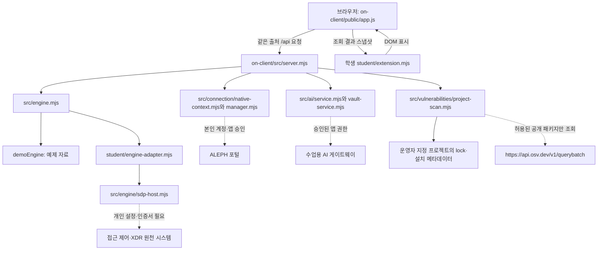

# 나라찬 보안 Agent 실행 설명서

이 문서는 같은 저장소의 `on-client` 앱을 실행하고 확인하는 방법을 설명합니다. 학생이 작성한 문서이며, 제공된 [시작·실행 안내](../on-client/docs/STUDENT_LAUNCH_GUIDE.md)를 대체하지 않습니다. 포털에서 정한 이름은 나라찬이고, 시작 틀의 실행 화면과 명령 출력에는 케셰브가 표시됩니다.

## 1. 환경과 작업 위치

| 항목 | 기준과 실제 확인 |
|---|---|
| 운영체제 | Windows에서 실행합니다. 2026-10-28에 Windows 11 Pro 64비트에서 확인했습니다. macOS·Linux는 확인하지 않았습니다. |
| Node.js | 실행 도구는 22~24를 지원합니다. `on-client/package.json`의 수업 기준은 24.19.0이고, 이번 실제 실행 버전은 24.21.0입니다. |
| PowerShell | 공식 명령은 Windows PowerShell을 사용합니다. 이번 확인 버전은 5.1.26100.9711입니다. 작업 도구의 PowerShell 7.6.5와 구분합니다. |
| 시작 틀 | `on-client/package.json` 기준 0.2.21입니다. |
| 추가 설치 | `on-client/package.json`에는 외부 dependencies가 없습니다. 로컬 앱 실행을 위해 `npm install`을 할 필요가 없습니다. |

현재 작업한 Git 저장소는 `https://github.com/PeterAhnn/choi-bujang-secret-vault`입니다. 이 PC의 Git 최상위는 다음 폴더입니다.

```text
C:\Users\Administrator\Desktop\SKT ALEPH\SKT-ALEPH\SKT-ALEPH-Defense-My-Library
```

앱 실행 위치는 그 안의 `on-client`입니다. 커밋은 Git 최상위에서 합니다. 다른 PC에서는 저장소를 둔 실제 위치에 맞춰 경로만 바꿉니다. 기존 Workbench의 별도 저장소 `SKT-ALEPH-Defence-KESHEV`와 파일을 섞지 않습니다.

```text
저장소/
├─ README.md, package.json, package-lock.json  웹 자료실의 안내·의존성
├─ api/, src/, public/                       웹 자료실의 서버·화면
├─ on-client/
│  ├─ package.json                           로컬 앱의 명령·기준 버전
│  ├─ tools/start-alekov.ps1                  제공 실행 도구
│  ├─ src/server.mjs                         제공 로컬 서버
│  ├─ public/app.js                          제공 공통 화면·요청 수명 관리
│  ├─ student/extension.mjs                  13~20단계 학생 표시 함수
│  ├─ student/engine-adapter.mjs              제공된 연결 어댑터
│  └─ docs/                                 제공 문서
├─ docs/STUDENT_RUNBOOK.md                   이 학생 실행 설명서
└─ verification/stage13~stage20/             단계별 검사·공식 판정 기록
```

저장소 루트의 잠금 파일은 웹 자료실 의존성입니다. `on-client` 자체의 잠금 파일로 설명하지 않습니다. 제공 ZIP의 `.env.example`은 로컬에 있으나 이 저장소의 `.env*` 제외 규칙으로 커밋에 포함되지 않습니다. 해당 파일은 견본이며 서버가 자동으로 읽지 않습니다. 실행에 필요한 비밀 없는 설정 관계는 아래 표로 확인할 수 있습니다.

| 설정 이름 | 현재 코드에서의 의미 |
|---|---|
| ON_PORT | 서버 기본값은 5189이며 실행 도구의 `-Port`가 자식 서버에 전달합니다. |
| ON_ENGINE_ADAPTER | 명시된 모듈 경로를 서버가 읽습니다. SDP 설정을 사용하면 제공 `student/engine-adapter.mjs`를 기본 선택하며, 설정 없이 임의로 연결을 만들지 않습니다. |
| ON_PROJECT_DIRECTORY | 운영자가 OSV 조회 대상의 절대 경로를 준비합니다. 현재 실행에는 없어 not_configured를 반환합니다. |
| ON_APPROVED_PUBLIC_PACKAGES | 운영자의 공개 조회 허용 목록입니다. 기본은 빈 배열이며 학생이 늘리지 않습니다. |

## 2. 예제 화면 실행·종료·재실행

기존 5189 앱을 유지하면서 확인하려면 별도 5193 포트를 사용합니다. 파일 탐색기에서 아래 `on-client` 폴더를 열고 주소 표시줄에 `powershell`을 입력해 새 창을 엽니다. 또는 새 PowerShell 창에서 다음 위치로 이동합니다.

```powershell
Set-Location -LiteralPath 'C:\Users\Administrator\Desktop\SKT ALEPH\SKT-ALEPH\SKT-ALEPH-Defense-My-Library\on-client'
node --version
powershell -NoProfile -ExecutionPolicy Bypass -File .\tools\start-alekov.ps1 -Demo -Port 5193
```

정상 시작 신호는 다음 두 줄입니다. 버전이 수업 기준과 다르면 그 앞에 참고 문구가 나올 수 있습니다.

```text
케셰브가 켜졌습니다. 브라우저에서 http://127.0.0.1:5193/ 을 여세요.
서버가 응답한 것만 확인했습니다. AI 연결 상태는 화면에서 따로 확인해 주세요.
```

1. 브라우저에서 `http://127.0.0.1:5193/`을 엽니다. 보호 현황·업무 앱·보안 기록 메뉴가 표시됩니다.
2. 보호 현황의 학생 표시에서 예제 자료·연습 사용자·연습 PC를 확인합니다. 예제는 실제 계정·운영 시스템 연결이 아닙니다.
3. 실행한 PowerShell 창에서 `Ctrl+C`를 누릅니다. 해당 포트가 응답하지 않는지 확인합니다. 다른 앱의 창이나 프로세스는 종료하지 않습니다.
4. 같은 폴더에서 같은 실행 명령을 다시 실행하고 브라우저를 새로고침합니다. 예제 표시가 다시 보이면 재실행 확인입니다.

포트가 사용 중이면 기존 프로그램을 종료하지 말고 `-Port 5195`처럼 비어 있는 번호로 바꿉니다. 브라우저 주소도 같은 번호를 사용합니다. `-ExecutionPolicy Bypass`는 이 명령 실행에만 적용되며 전역 정책을 바꾸지 않습니다.

창 없이 실행하려면 같은 명령 끝에 `-Background`를 붙입니다. 이 경우 출력된 **해당 node 프로세스 번호**만 작업 관리자에서 종료합니다. 이 문서의 기본 절차는 전경 실행과 `Ctrl+C`입니다.

## 3. 기본 실행과 연결 범위

실제 계정 연결 절차를 사용할 때는 같은 앱 폴더에서 다음 공식 명령을 사용합니다. 5189가 사용 중이면 비어 있는 포트를 지정합니다.

```powershell
powershell -NoProfile -ExecutionPolicy Bypass -File .\tools\start-alekov.ps1
```

실행 도구는 프로젝트별 계정 연결용 개인 설정을 Windows 사용자 폴더에 준비하거나 검증한 기존 설정을 재사용합니다. 이 준비만으로 계정·AI가 연결되지는 않습니다. 실제 비밀 설정 파일은 프로젝트·Git 밖에 둡니다. `npm start`는 이 준비 절차를 대신하지 않습니다.

연결은 제공 화면의 계정 연결 확인 → 같은 계정·번호의 본인 승인 → AI 앱 승인 → AI 연결 점검 순서입니다. 비밀번호·토큰·API 키를 문서나 코드로 옮기지 않습니다. 실제 승인과 유료 AI 요청은 별도 사용자 판단이 필요하며 이 설명서 확인에서는 실행하지 않습니다.

접근 제어·XDR의 실제 조회에는 담당자가 발급한 개인 설정·인증서와 연결 어댑터가 필요합니다. 이번 계정에는 실제 원천 연결을 확인하지 않았습니다. 기본 실행의 연결 없음은 이 사실을 표시하며 단계 통과 기록을 취소하는 뜻이 아닙니다. 제공 안내의 `-SdpHostConfig`는 발급받은 설정이 있을 때만 사용하며 임의로 설정 파일이나 대응 등록을 만들지 않습니다.

## 4. 구성과 데이터 흐름

표의 경로는 저장소 기준이며 구성도의 `src/`·`student/`는 `on-client` 안을 가리킵니다. 실선은 로컬 코드의 관계이고 점선은 설정·승인이 있어야 사용하는 외부 연결입니다. 외부 연결이 모두 활성화됐다는 뜻이 아닙니다.



브라우저는 로컬 서버에 요청하고 학생 함수는 받은 값을 표시합니다. 학생 함수가 키를 받아 외부 AI·OSV·SDP를 직접 호출하지 않습니다. 실행 중 요청의 취소·시간 초과·세대 확인은 제공 `public/app.js`가 담당합니다. AI의 조치 제안과 서버의 실제 집행·효과 관측은 다른 결과입니다.

## 5. 제공 기능과 학생 구현

| 구분 | 실제 파일·함수 | 역할 |
|---|---|---|
| 학생 13 | `on-client/student/extension.mjs`의 renderIdentity | 사용자·기기·세션 상태와 오류를 표시합니다. |
| 학생 14 | 같은 파일의 renderDecision | 앱 판정·이유·시각과 요청 실패를 구분합니다. |
| 학생 15 | 같은 파일의 renderEvents | 받은 기록의 정렬·세 필터·근거·규칙 상세를 표시합니다. |
| 학생 16 | 같은 파일의 renderStatus | 상태·알림·진단값 여섯 개의 수동 복사를 처리합니다. |
| 학생 17 | 같은 파일의 renderAiConnection | AI 연결 점검 상태와 사건 설명 미실행을 구분합니다. |
| 학생 18 | 같은 파일의 renderExplanation | 현재 사건의 근거·규칙·확인 불가와 미실행 제안을 표시합니다. |
| 학생 19 | 같은 파일의 renderAction | 준비·사람 확인·접수·효과 관측·결과 불명을 구분합니다. |
| 학생 20 | 같은 파일의 renderVulnerabilities | 정확한 버전·출처·시각·부분 결과·미조회·실패를 표시합니다. |
| 제공 실행·통신 | `on-client/tools/start-alekov.ps1`, `on-client/src/server.mjs`, `on-client/public/app.js` | 앱 실행, API, 안전한 응답, 취소와 이전 응답 폐기를 담당합니다. |
| 제공 연결·처리 | `on-client/src/engine/`, `on-client/src/ai/`, `on-client/src/actions/`, `on-client/src/vulnerabilities/` | 원천 연결, AI 중계, 조치 처리와 공개 패키지 조회를 담당합니다. |
| 제공 PC 상태 | `on-client/src/pc-status.mjs`, `on-client/public/pc-status-view.mjs` | 로컬 PC 상태를 읽고 표시합니다. 학생 구현 성취와 구분합니다. |

## 6. 오류 확인 순서

| 표시·코드 | 확인 순서와 다시 시도 조건 |
|---|---|
| Node.js 없음·지원 밖 버전 | `node --version`과 설치 위치를 확인합니다. 22~24를 설치한 뒤 새 PowerShell을 엽니다. |
| 앱 폴더가 아닙니다 | 현재 위치와 `tools/start-alekov.ps1`, `src/server.mjs`, `package.json` 존재를 확인합니다. 실제 on-client 폴더로 이동합니다. |
| 포트를 다른 프로그램이 사용 | 기존 프로그램은 유지하고 `-Port`와 브라우저 주소를 함께 바꿉니다. |
| ENGINE_NOT_CONNECTED·연결 없음 | 예제·기본 실행을 구분하고 제공된 SDP 설정이 있는지 확인합니다. 발급되지 않은 자격을 만들지 않습니다. |
| NATIVE_HOST_DISABLED | 최신 실행 도구로 켰는지 확인합니다. Demo·NoNativeHost 실행은 계정 연결용 실행이 아닙니다. |
| NATIVE_HOST_UNVERIFIED·OUTCOME_UNKNOWN | 연결 성공으로 보지 않습니다. 「현재 로그인 확인」을 한 번 누르고 지속되면 안전한 도움정보와 공식 오류 안내를 확인합니다. 같은 승인 요청을 반복하지 않습니다. |
| ON_AI_PROVISIONING_PENDING | 계정 연결·AI 앱 승인 여부와 운영자 앱 권한 준비를 구분합니다. 키를 복사하거나 다른 모델을 추가하지 않습니다. |
| CONTRACT_MISMATCH | 빈 목록이나 정상으로 보지 않습니다. 「다시 불러오기」로 한 번 재조회하고 지속되면 응답 계약·확인 범위의 운영 상태를 확인합니다. |
| TIMEOUT·NETWORK_ERROR·CANCELLED | 이전 결과를 현재 값으로 보지 않습니다. 원인을 확인한 뒤 제공 버튼으로 수동 재시도합니다. |
| not_configured·not_checked | 각각 조회 프로젝트 설정 없음·승인 공개 패키지 없음입니다. 취약점 없음이 아닙니다. 운영자 설정을 임의로 바꾸지 않습니다. |

상세 코드별 절차는 제공 [CONNECTION_TROUBLESHOOT.md](../on-client/docs/CONNECTION_TROUBLESHOOT.md)에 있습니다. 「도움정보 불러오기」나 「연결 도움정보 보기」는 수동 조회이며 자동 전송이 아닙니다. 내용은 본인이 확인하고 비밀 설정값·키·토큰을 공유하지 않습니다. 이번 작업의 외부 문의는 보류 상태입니다.

## 7. 확인한 범위와 미확인 범위

| 항목 | 확인 수준·근거 |
|---|---|
| 13~20단계 | 포털의 공식 커밋 원문 검토를 통과했습니다. 코드를 운영 서버에서 실행해 인증한 결과는 아닙니다. [20단계 공식 기록](../verification/stage20/official-review-20261028.json)에서 최신 결과를 확인합니다. |
| 학생 표시 분기 | 단계별 모의 입력 검사와 사용자 직접 화면 확인을 구분해 `verification/stage13~stage20/`에 기록했습니다. 합성 사건·OSV 응답은 실제 자료가 아닙니다. |
| 17단계 계정·AI 점검 | 2026-10-28에 본인 승인과 verified·모델 1개를 확인했습니다. 현재 항상 연결돼 있다는 뜻이나 사건 설명 성공은 아닙니다. |
| 실제 원천·사건 설명·조치 | SDP 원천 기록 미연결입니다. 실제 사건 설명·조치 집행·효과 관측·결과 재조회는 미확인 또는 기다림(UNV)입니다. |
| 실제 OSV | 앱은 not_configured입니다. 실제 외부 조회 성공은 미확인입니다. 두 공개 패키지의 잠금 파일·설치 메타데이터 버전 대조만 별도로 확인했습니다. |
| 21단계 명령 사전 검증 | 공식 실행 도구의 Demo·5194·Background 경로로 시작·HTTP 200·종료·재실행을 확인했습니다. 사용자 직접 실행 확인과 별도입니다. |
| 21단계 사용자 직접 확인 | 새 PowerShell의 Demo·5193 전경 실행·종료·재실행, 문서의 경로·명령·메뉴·버튼 이름 일치를 본인이 확인했습니다. [실행 확인 기록](../verification/stage21/runtime-check.json)에 두 응답을 구분해 기록했습니다. |

버전·출처·시각이 없는 값은 추정해 채우지 않습니다. 예제 화면, 실제 로컬 실행, 실제 외부 연결, 공식 코드 검토를 구분합니다.
